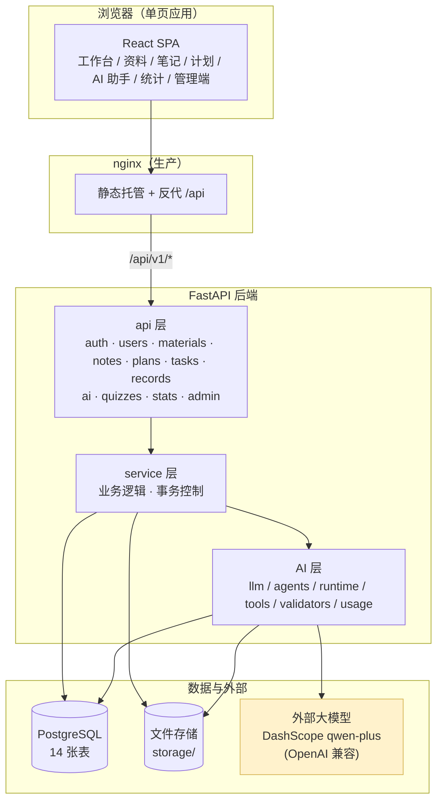
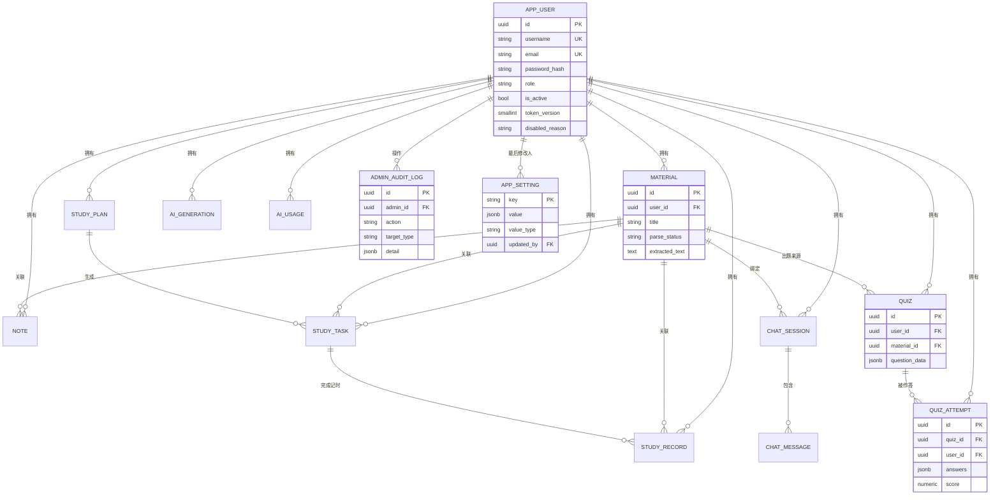
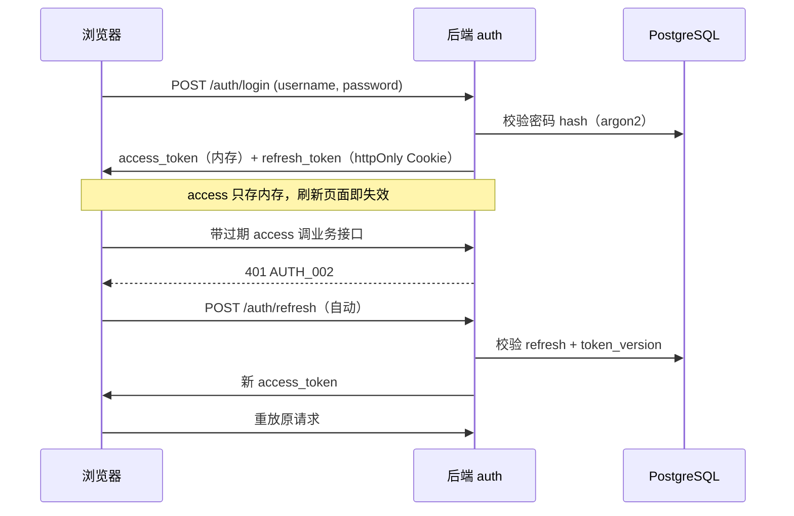
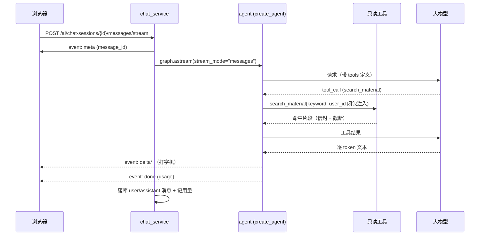
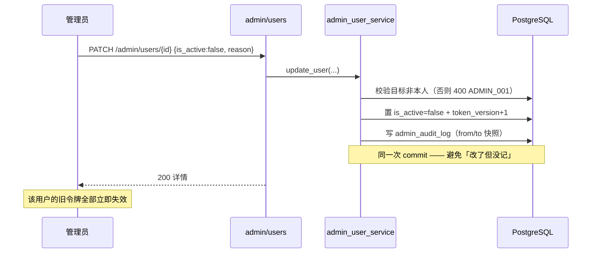

# 论文材料（架构 / 设计 / 测试依据）

> 本文档是毕业设计论文第 3~5 章（系统设计、实现、测试）的原始素材，
> 所有图用 Mermaid 书写，可在支持 Mermaid 的编辑器 / GitHub / Typora 中直接渲染。
> 数据口径以 `docs/api.md`、`docs/db.md`、`docs/agent-tools.md` 为准。

## 1. 系统概述

一个面向个人学习者的 Web 系统：上传学习资料（PDF / Word）→ 解析正文 → 制定学习计划与每日任务 →
完成任务记录学习时长 → 借助大语言模型完成**问答、总结、出题、判分、学习建议** → 用图表呈现学习数据，
另设管理员端负责用户、内容、AI 用量与系统配置管理。

### 1.1 功能清单（13 项）

| 编号 | 功能 | 编号 | 功能 |
|---|---|---|---|
| 1 | 用户注册登录 | 8 | AI 资料总结 |
| 2 | 个人信息管理 | 9 | AI 测试题生成与判分 |
| 3 | 学习资料管理 | 10 | 个性化学习推荐 |
| 4 | 在线笔记管理 | 11 | 学习数据统计分析 |
| 5 | 学习计划管理 | 12 | 学习记录管理 |
| 6 | 每日任务管理 | 13 | 管理员端（13.1 仪表盘 / 13.2 用户 / 13.3 内容 / 13.4 AI 用量 / 13.5 配置与审计） |
| 7 | AI 智能问答 | | |

### 1.2 技术栈

| 层 | 选型 | 说明 |
|---|---|---|
| 前端 | React 19 + TypeScript + Vite 8 + antd 6 + TanStack Query + ECharts | 路由级懒加载、独立 chunk |
| 后端 | Python 3.12 + FastAPI + SQLModel（SQLAlchemy 2 异步）+ asyncpg | 分层：api → service → model |
| 数据库 | PostgreSQL 18（Docker） | 14 张表，JSONB 存题目/答卷/配置 |
| AI | LangChain `create_agent` + DashScope（通义千问 `qwen-plus`） | 四个场景：qa / summary / quiz / advice |
| 部署 | Docker Compose（PG + 后端 + 前端 nginx） | 一键 `up -d --build` |

## 2. 系统架构



依赖方向（`CLAUDE.md` §5）：`api → service → model`，AI 层通过 service 的只读工具访问数据，**不直接写库**；
唯一横切的是「用量与配额」（`ai/usage.py`）与「配置」（`app_setting`）。

## 3. 数据库 E-R 图



设计要点（`docs/db.md`）：

- **软删除**（`deleted_at`）为主；`quiz_attempt` 不软删除（它是统计依据，下架题目后历史答卷仍计入统计）。
- **多租户过滤写在 SQL 里**：每条查询都带 `user_id = 当前用户`，越权统一返回 404。
- **枚举用 VARCHAR + CHECK**，不用 PG 原生 ENUM（`CLAUDE.md` §6）。
- **角色读库判定**：JWT 只带 `sub/pv/typ`，权限不信令牌里的角色声明。

## 4. 关键时序

### 4.1 登录与令牌刷新（功能 1）



### 4.2 AI 智能问答（SSE 流式 + 工具调用，功能 7）



关键点：**工具只读**、`user_id` 由闭包注入（模型无法越权）、失败也落库（`ok=false`）、SSE 每 15s 心跳防代理断连。

### 4.3 管理员禁用用户（审计与业务同事务，功能 13.2）



## 5. 测试情况

### 5.1 后端

- **227 个 pytest 用例**全部通过；`ruff` 静态检查零告警。
- 分支/行覆盖率 **82%**（3926 语句，HTML 报告 `backend/htmlcov/index.html`）。
- 打桩策略：AI 场景把「模型调用」收敛在 `ai_common.invoke_structured` 单点打桩，
  「配额 → 调用 → 二次校验 → 落库 → 记用量」真实链路仍被覆盖；工具与判分为纯函数，直接单测。

| 里程碑 | 新增用例数 | 重点覆盖 |
|---|---|---|
| M0 | 4 | `/health`、数据库连通 |
| M1 | 41 | 注册登录、JWT 刷新、改密后旧令牌失效、CSRF |
| M2 | +7 | 上传/解析/分片/下载、中文文件名 |
| M3 | +14 | 笔记 CRUD、搜索、列表不含正文 |
| M4 | +35 | 计划→任务→记录链路、幂等生成、完成率口径 |
| M5 | +39 | 4 场景 service、6 只读工具、用量配额、SSE |
| M6 | +16 | 统计补零、推荐规则、全局异常 |
| M6b | +42 | 管理端 5 子模块、审计同事务、自我保护、N+1 |

### 5.2 前端

- `tsc --noEmit` 类型检查 + `vite build` 通过。
- 全部页面经真实浏览器手测：登录、资料、笔记、计划、AI 助手（含 SSE 打字机）、统计图表、管理端五页。
- antd 6 废弃告警清零；ECharts 按需注册（统计 chunk gzip 193 KB）。

## 6. 关键设计取舍（答辩可讲）

1. **契约先行**：`api.md` / `db.md` / `agent-tools.md` 是代码上游，接口以「方法+路径表」为准。
2. **Access token 只存内存 + httpOnly refresh Cookie**：兼顾 XSS 与 CSRF，CSRF 用 Origin 校验。
3. **角色读库判定、`token_version` 吊销**：改密/改角色/禁用/强制下线即时生效。
4. **AI 只读工具 + 信封 + 截断 + 不抛异常**：模型无法越权，坏输出不影响系统。
5. **总结/出题不挂 `read_material_chunk`**：正文已由 service 注入，挂工具反而引发步数超限（实测 tokens 6651→870）。
6. **规则推荐（秒回、可解释）与 AI 建议（叙述性）分层**：两条线互补。
7. **管理端不提供 AI 生成接口**：成本与内容合规上的边界。
8. **下架题目不影响历史统计**：报表可复现。
9. **`app_setting` KV + 60s 缓存写后即清**：运行时开关无需重启。
10. **供应商可插拔**：模型只收敛在 `app/ai/llm.py`，换供应商改 `.env` 三个变量。

## 7. 部署

```bash
# 一键起全套（PG + 后端 + 前端 nginx）
docker compose -f deploy/docker-compose.yml up -d --build
# 打开 http://127.0.0.1:8080 ；后端 /health 看状态

# 第一个管理员（管理端不能给自己提权）
docker exec -it sls-backend python scripts/create_admin.py --username admin --email a@b.c --password xxx
```

- 后端容器启动时自动 `alembic upgrade head`；上传文件用 `uploads` volume 持久化。
- 敏感项（`LLM_API_KEY` / `SECRET_KEY`）从 `deploy/.env` 注入（不入库）。
